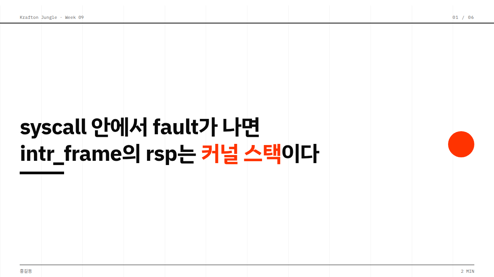
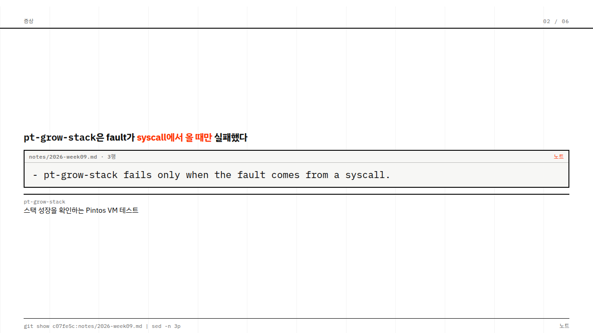
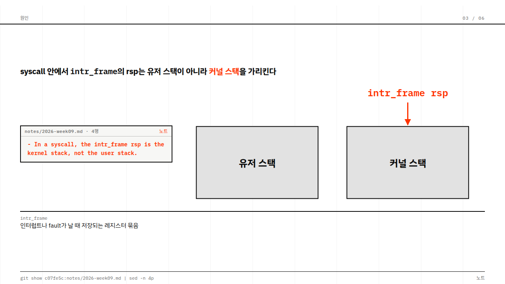
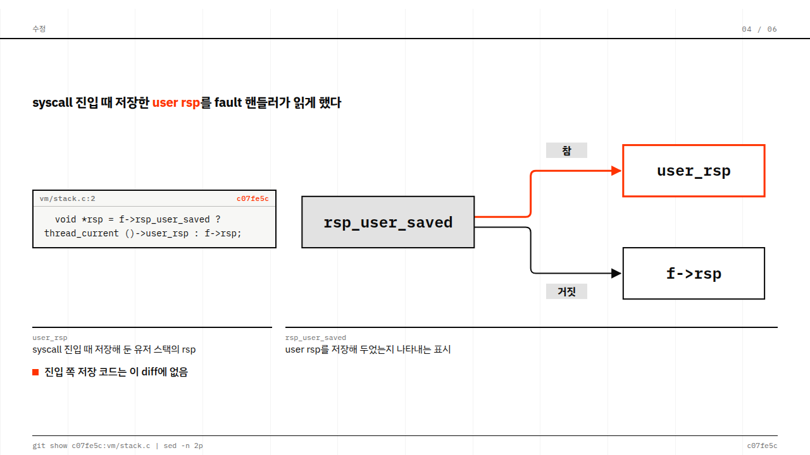
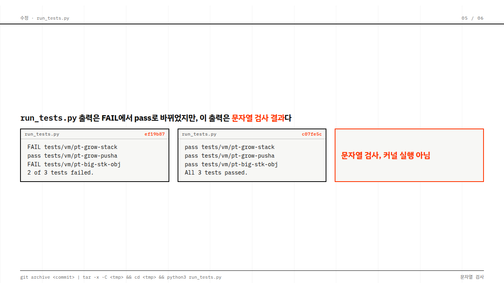
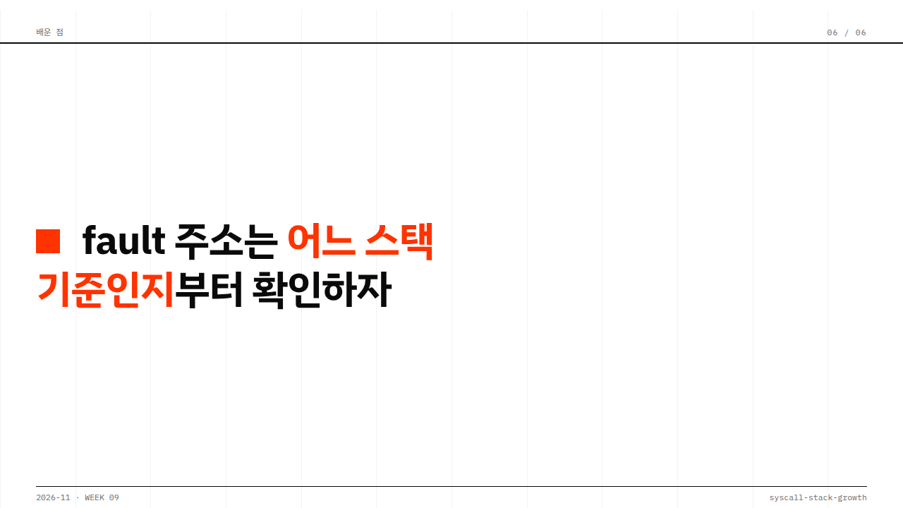

# 손대지 않은 첫 초안: week07-stack-growth

`cases/week07-circular-list/DESIGN.md`를 기본 디자인으로 지정해서 새 주제로 만든 발표예요. 스킬이 만든 첫 초안이고, 사람이 손대지 않았어요.

- **한 번 돌린 결과예요.** 최솟값을 보장하지 않아요.
- **질문 단계의 답은 합성 데이터예요.** 학생 역할을 에이전트가 맡았고, 발표 내용과 커밋도 합성 데이터예요. 슬라이드 구성안은 스킬이 제안한 것을 모두 받았어요.
- **사례의 구성이 들어갔어요.** 코드 옆에 도식을 두는 `Scene`과 3열 `Compare`를 썼어요. 사례의 이름 붙은 도식 부품(`Ring closure` 등)은 이 주제에 맞지 않아서 쓰지 않았어요.

이 정도를 기준으로 삼고, 여기서 직접 다듬어 가세요. 스킬은 이 폴더를 읽지 않아요. 에이전트가 베끼지 않도록 HTML 없이 이미지만 두었어요.

각 이미지는 슬라이드의 모든 단계를 펼친 상태예요.

