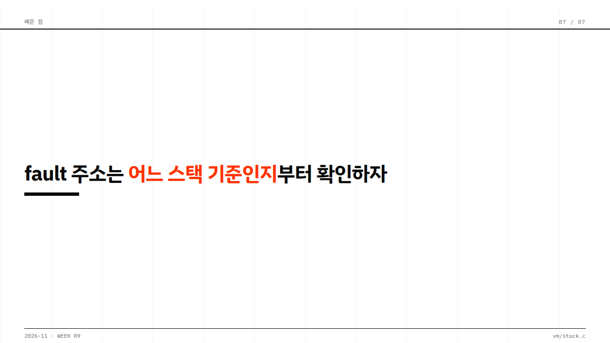

# 손대지 않은 첫 초안

`cases/week07-circular-list/DESIGN.md`를 기본 디자인으로 지정하고, `cases/week08-p2-team-workflow/DESIGN.md`에서 브랜치 그래프 부품만 빌려서 새 주제로 만든 발표예요. 스킬이 만든 첫 초안이고, 사람이 손대지 않았어요.

- **한 번 돌린 결과예요.** 최솟값을 보장하지 않아요. 다른 사례로는 이렇게 전체를 재현해 보지 않았어요.
- **스킬의 질문 단계를 거쳤어요.** 합성 학생 역할을 에이전트가 맡아 답했어요. 발표 내용과 커밋도 합성 데이터예요.
- **장면 전환이 없어요.** 사례를 고르기 전에 슬라이드 구성이 정해져서, 사례의 장면 부품이 쓰이지 않았어요(이슈 #42).

이 정도를 기준으로 삼고, 여기서 직접 다듬어 가세요. 스킬은 이 폴더를 읽지 않아요. 에이전트가 베끼지 않도록 HTML 없이 이미지만 두었어요.

각 이미지는 슬라이드의 모든 단계를 펼친 상태예요.

